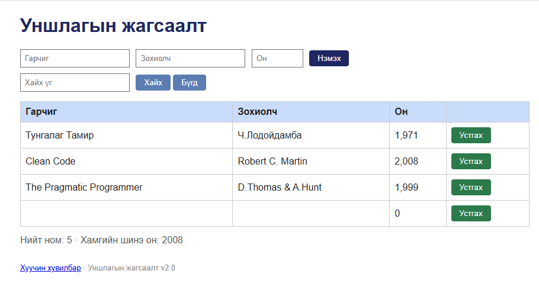

# BUG-02: Хоосон эсвэл дутуу талбартай ном нэмдэг

Орчин: Reading List v2.0 UI reproduction, Opera One 136.0.6008.80 (Chromium 152.0.7977.134), Windows 11 64-bit, 2026-10-15
Урьдчилсан нөхцөл: App default 3 seeded book state-д байна.

## Дахин гаргах алхам
1. Гарчиг, Зохиолч, Он талбаруудыг бүгдийг хоосолно.
2. “Нэмэx” товчийг дарна.
3. Дараа нь нэг нэг талбарыг хоосон үлдээн, бусад хоёрт утга оруулж тус бүр илгээнэ.
4. Гарчиг эсвэл зохиолчид ганц хоосон зай өгч, үлдсэн талбаруудыг хүчинтэй утгаар бөглөн тус бүр илгээнэ.
5. Шинэ мөр, тоолуур, статус мессежийг шалгана.
6. Аппыг reload хийж мөр хэвээр эсэхийг шалгана.

Хүлээгдэж байсан: Гурван талбар бүгд заавал бөглөгдөнө; дутуу бол ном нэмэгдэхгүй, ойлгомжтой алдааны мессеж харагдана.
Бодит үр дүн: Бүх талбар хоосон үед “Ном нэмэгдлээ” гэж харуулаад хоосон мөр нэмсэн; Он 0 болж харагдаж, нийт тоо өссөн. Мөн гарчиг, зохиолч, эсвэл он тус бүрийг дангаар нь хоосон үлдээсэн үед бичлэгийг зөвшөөрсөн. Гарчиг эсвэл зохиолчид зөвхөн хоосон зай өгсөн бичлэг ч нэмэгдсэн. Reload-ийн дараа хоосон бичлэг үлдсэн.
Ноцтой байдал: Major — утгагүй бичлэг өгөгдөлд нэмэгдэж, жагсаалтыг бохирдуулна.
Хавсралт:  · [curl -i evidence](../evidence/bug-02-curl.txt)
Олдсон аялал: Couch Potato, Saboteur.

Нэмэлт API баталгаа: POST /api/books-д {} илгээхэд HTTP 201 Created буцааж, title ба author хоосон бичлэг үүсгэсэн.
