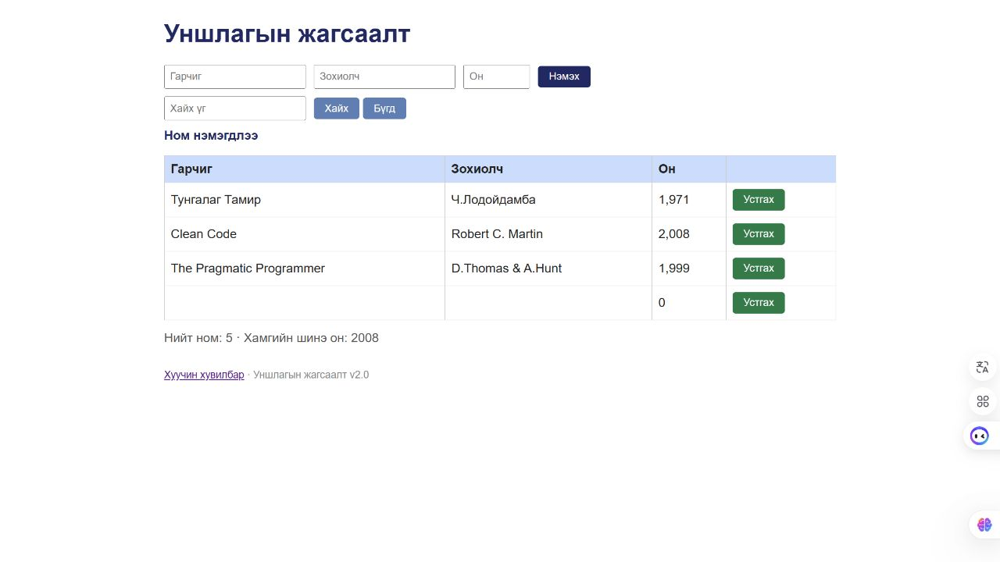

# BUG-02: Хоосон эсвэл дутуу талбартай номыг амжилттай нэмдэг

Орчин: Reading List v2.0; Node.js v24.13.0; Codex In-app Browser (ажигласан User-Agent Chrome/155.0.0.0); Windows x64, 25H2, build 26200.9711; 2026-10-21.
API хэрэгсэл: curl.exe 8.21.0.
Урьдчилсан нөхцөл: Өмнөх node app.js process-ийг Ctrl+C-ээр зогсоож node app.js-ийг дахин асаасан; браузераа reload хийсэн; GET /api/books нь id 1, 2, 3 бүхий Тунгалаг Тамир, Clean Code, The Pragmatic Programmer гэсэн яг гурван ном буцаана. Page reload дангаараа server reset биш.

## Дахин гаргах алхам

1. Гарчиг, Зохиолч, Он гурван талбарыг хоосон хэвээр үлдээнэ.
2. Дэлгэцийн Нэмэx товчийг дарна.
3. Нэмэгдсэн мөр, статус, тоолуурыг ажиглана.
4. Page reload хийгээд хоосон мөр хэвээр эсэхийг шалгана.

Хүлээгдэж байсан: Гурван талбар заавал бөглөгдөнө; дутуу бол ном нэмэгдэхгүй, ойлгомжтой алдааны мессеж харагдана.

Бодит үр дүн: Дөрөв дэх хоосон мөр үүсэж, Он нь 0, нийт тоо 5, мессеж Ном нэмэгдлээ болсон; reload-ийн дараа мөр үлдсэн. GUI-аас ирсэн хоосон оны хадгалсан утга нь "" бөгөөд UI үүнийг 0 болгон харуулсан. API-д {} илгээхэд 201, хоосон title/author, year талбаргүй бичлэг үүссэн.

Ноцтой байдал: Major — Заавал байх өгөгдөлгүй бичлэг хадгалагдаж жагсаалтыг бохирдуулна.

Олдсон аялал: Couch Potato, Saboteur.

## Хавсралт

[Шинэ server дээрх {} хүсэлтийн бүтэн curl](../evidence/session-03/bug-02-curl.txt) · [GUI хоосон мөрийн хадгалалт](../evidence/session-03/bug-02-ui-persistence-curl.txt)

## Нэмэлт тодруулга

Нэмэлт хувилбаруудыг тус бүр шинэ server дээр шалгасан: title хоосон / author=S03 Missing Title Author / year=2026; title=S03 Missing Author / author хоосон / year=2026; title=S03 Missing Year / author=Session Tester / year хоосон; title эсвэл author нь яг нэг U+0020 зай. Бүгд зөвшөөрөгдсөн; зургууд нь screenshots/session-03/missing-*.jpg болон whitespace-*.jpg дотор байна. Эдгээрийг зургаан тусдаа согог гэж тоолоогүй.
