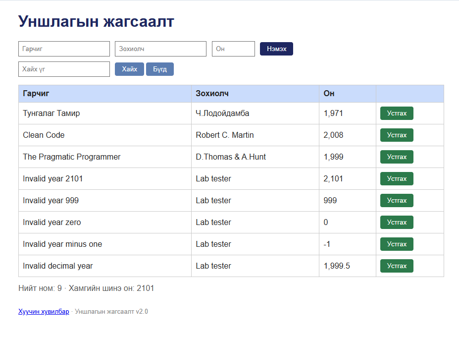

# BUG-03: Он 1000–2100 бүхэл тооны дүрмийг шалгахгүй

Орчин: Reading List v2.0 UI reproduction, Opera One 136.0.6008.80 (Chromium 152.0.7977.134), Windows 11 64-bit, 2026-10-15
Урьдчилсан нөхцөл: App default 3 seeded book state-д байна.

## Дахин гаргах алхам
1. Гарчиг ба зохиолч оруулна.
2. Он талбарт 2101 оруулж “Нэмэx” дарна.
3. 0, 999, -1, 1999.5 болон not-a-year утгаар тус тус дахин шалгана.

Хүлээгдэж байсан: Он нь 1000–2100 хоорондох бүхэл тоо; хязгаараас гадуур эсвэл бүхэл биш утгыг хүлээн авахгүй.
Бодит үр дүн: 0, -1, 999, 2101 бүгд нэмэгдсэн; 2101 хамгийн шинэ он болж тоолуурт гарсан. 1999.5 утга мөн нэмэгдэж хүснэгтэд 1,999.5 гэж харагдсан. not-a-year утга нэмэгдэж хүснэгтэд NaN гэж харагдсан. Хүчинтэй заагийн 1000 болон 2100 утгууд нэмэгдсэн.
Ноцтой байдал: Major — аппын үндсэн өгөгдлийн дүрэм зөрчигдөж, хуурамч он статистикт орно.
Хавсралт: 
Олдсон аялал: Couch Potato, Fed-Ex.
