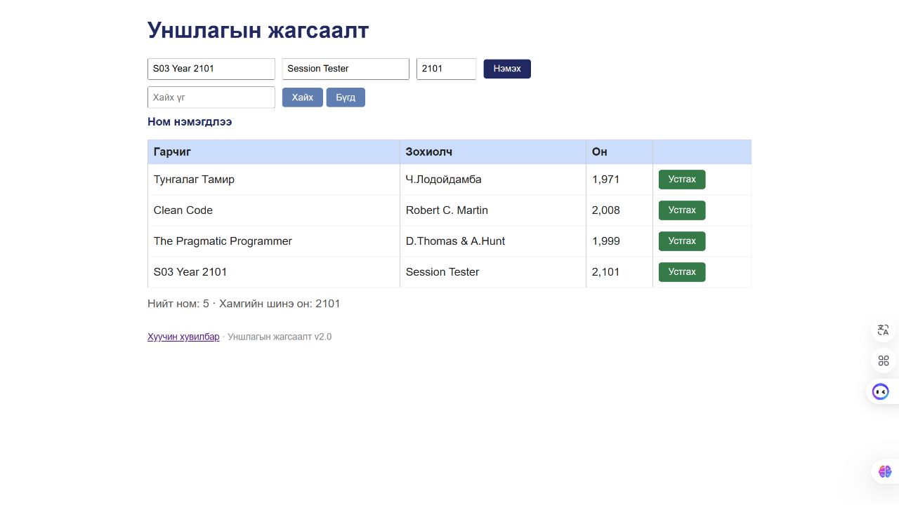

# BUG-03: Он 1000–2100 хоорондох бүхэл тоо байх дүрмийг зөрчсөн утгыг хадгалдаг

Орчин: Reading List v2.0; Node.js v24.13.0; Codex In-app Browser (ажигласан User-Agent Chrome/155.0.0.0); Windows x64, 25H2, build 26200.9711; 2026-10-21.
API хэрэгсэл: curl.exe 8.21.0.
Урьдчилсан нөхцөл: Өмнөх node app.js process-ийг Ctrl+C-ээр зогсоож node app.js-ийг дахин асаасан; браузераа reload хийсэн; GET /api/books нь id 1, 2, 3 бүхий Тунгалаг Тамир, Clean Code, The Pragmatic Programmer гэсэн яг гурван ном буцаана. Page reload дангаараа server reset биш.

## Дахин гаргах алхам

1. Гарчигт S03 Year 2101, зохиолчид Session Tester, онд 2101 оруулна.
2. Нэмэx дарна.
3. Шинэ мөрийн он болон Хамгийн шинэ он утгыг уншина.

Хүлээгдэж байсан: Спецификацийн дагуу он нь 1000–2100 хоорондох бүхэл тоо; 2101-ийг татгалзаж ном нэмэхгүй.

Бодит үр дүн: 2101 онтой дөрөв дэх ном нэмэгдэж, хүснэгтэд 2,101, хамгийн шинэ он 2101 болсон. 999, 0, -1, 1999.5, not-a-year мөн зөвшөөрөгдсөн; сүүлийн хоёр нь 1,999.5 ба NaN гэж харагдсан.

Ноцтой байдал: Major — Хүчин төгөлдөр бус он өгөгдөл болон статистикт орж байна.

Олдсон аялал: Fed-Ex.

## Хавсралт

[API-аар 2101 хадгалсны бүтэн curl](../evidence/session-03/bug-03-curl.txt) · [Тоон бус оны хадгалсан утга](../evidence/session-03/year-nonnumeric-curl.txt)

## Нэмэлт тодруулга

Хүчинтэй 1000, 2100 заагийг positive control болгон шалгахад зөвшөөрсөн. Нэмэлт хувилбар бүрийг давтахдаа server-ийг шинээр асааж, ижил author болон давхцахгүй title хэрэглэж болно. Зөвшөөрөл/татгалзлын согогийг хүчинтэй оны таслалтай форматын BUG-08-аас тусад нь тооцсон.
