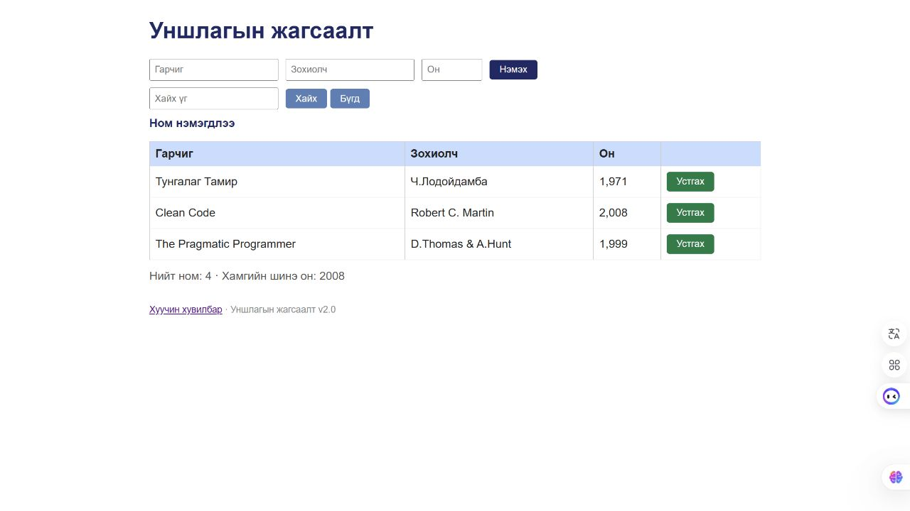

# BUG-05: Ном устгасны дараа Ном нэмэгдлээ гэсэн буруу мессеж харуулдаг

Орчин: Reading List v2.0; Node.js v24.13.0; Codex In-app Browser (ажигласан User-Agent Chrome/155.0.0.0); Windows x64, 25H2, build 26200.9711; 2026-10-21.
API хэрэгсэл: curl.exe 8.21.0.
Урьдчилсан нөхцөл: Өмнөх node app.js process-ийг Ctrl+C-ээр зогсоож node app.js-ийг дахин асаасан; браузераа reload хийсэн; GET /api/books нь id 1, 2, 3 бүхий Тунгалаг Тамир, Clean Code, The Pragmatic Programmer гэсэн яг гурван ном буцаана. Page reload дангаараа server reset биш.

## Дахин гаргах алхам

1. S03 Valid Flow / Session Tester / 2026 гэсэн хүчинтэй ном нэмнэ.
2. Page reload хийж статус мессеж хоосон болсныг шалгана; шинэ ном жагсаалтад хэвээр байна.
3. Зөвхөн S03 Valid Flow мөрийн Устгах товчийг дарна.
4. Анхны гурван ном үлдсэн эсэх болон статусыг уншина.

Хүлээгдэж байсан: Спецификацийн дагуу үйлдлийн дараах мессеж тухайн устгах үйлдэлдээ тохирсон байх ёстой.

Бодит үр дүн: Туршилтын ном арилж анхны гурван ном үлдсэн ч Ном нэмэгдлээ гэсэн мессеж шинээр гарсан. Reload өмнөх add мессежийг арилгасан тул зүгээр хуучин мессеж үлдсэн гэж дүгнээгүй.

Ноцтой байдал: Minor — Устгалын үр дүнг хэрэглэгч буруу ойлгож болно; мөр өөрөө зөв устаж байна.

Олдсон аялал: Fed-Ex.

## Хавсралт

[Нэмэхийн өмнөх/дараах хяналт](../screenshots/session-03/valid-add.jpg)

## Нэмэлт тодруулга

Хуучин screenshots/bug-05.png нь хоёр seeded номтой өөр дарааллын хожуу зураг байсан тул одоогийн алхмын үндсэн нотолгоо болгож ашиглаагүй.
