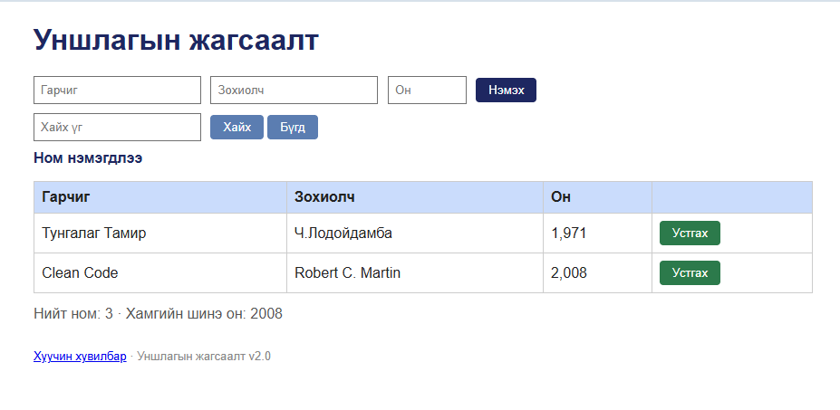

# BUG-05: Устгасны дараа “Ном нэмэгдлээ” гэсэн мессеж гардаг

Орчин: Reading List v2.0, Codex In-app Browser (version unavailable), Windows (version unavailable), 2026-10-15  
Урьдчилсан нөхцөл: App default 3 seeded book state-д байна; статус хэсэг хоосон.

## Дахин гаргах алхам
1. Туршилтын ном нэмнэ.
2. Тэр номын “Устгах” товчийг дарна.
3. Мөр арилсан эсэх болон статус хэсгийг шалгана.

Хүлээгдэж байсан: Үйлдэл бүрийн дараах мессеж тухайн үйлдэлдээ тохирно.
Бодит үр дүн: Номын мөр арилсан боловч статус “Ном нэмэгдлээ” гэж үлдсэн.
Ноцтой байдал: Minor — хэрэглэгч устгал амжилттай эсэхийг буруу ойлгож магадгүй.
Хавсралт: 
Олдсон аялал: Supermodel, Fed-Ex.
