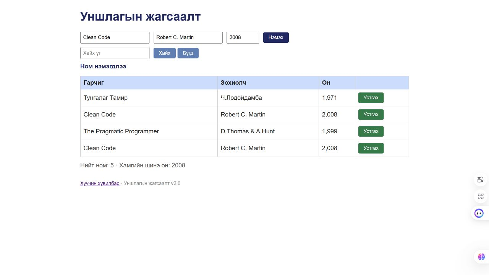

# BUG-06: Ижил гарчиг зохиолчтой номын давхардлыг хориглодоггүй

Орчин: Reading List v2.0; Node.js v24.13.0; Codex In-app Browser (ажигласан User-Agent Chrome/155.0.0.0); Windows x64, 25H2, build 26200.9711; 2026-10-21.
API хэрэгсэл: curl.exe 8.21.0.
Урьдчилсан нөхцөл: Өмнөх node app.js process-ийг Ctrl+C-ээр зогсоож node app.js-ийг дахин асаасан; браузераа reload хийсэн; GET /api/books нь id 1, 2, 3 бүхий Тунгалаг Тамир, Clean Code, The Pragmatic Programmer гэсэн яг гурван ном буцаана. Page reload дангаараа server reset биш.

## Дахин гаргах алхам

1. Гарчигт Clean Code, зохиолчид Robert C. Martin, онд 2008 оруулна.
2. Нэмэx дарж ижил гарчиг/зохиолчтой мөрийг тоолно.
3. Нэмэлт хувилбар: title/author-ийг хэвээр байлгаж онд 2009 оруулаад дахин нэмнэ.

Хүлээгдэж байсан: Спецификацийн дагуу ижил гарчиг, зохиолчтой ном давхардахгүй; он өөр байсан ч хос ижил тул хориглоно.

Бодит үр дүн: 2008 оны яг ижил хоёр мөр үүссэн; 2009 онтой гурав дахь ижил title/author хос ч зөвшөөрөгдсөн.

Ноцтой байдал: Major — Давхардсан үндсэн өгөгдөл хадгалагдаж жагсаалт, хайлт, статистикт нөлөөлнө.

Олдсон аялал: Fed-Ex.

## Хавсралт

[Өөр онтой давхардал](../screenshots/session-03/duplicate-different-year.jpg) · [Тусдаа шинэ server дээрх API баталгаа](../evidence/session-03/bug-06-curl.txt)
