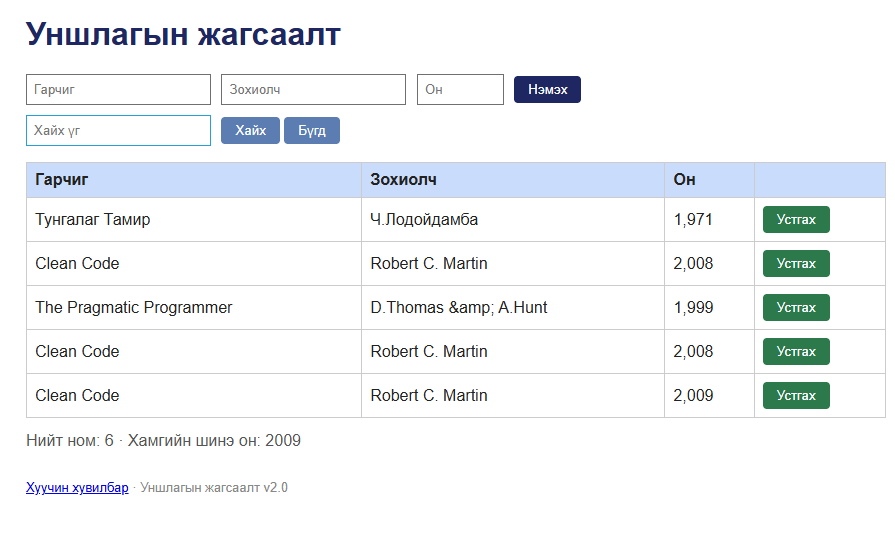

# BUG-06: Ижил гарчиг, зохиолчтой номыг давхар нэмж болдог

Орчин: Reading List v2.0 UI reproduction, Opera One 136.0.6008.80 (Chromium 152.0.7977.134), Windows 11 64-bit, 2026-10-15
Урьдчилсан нөхцөл: App default 3 seeded book state-д байна; Clean Code / Robert C. Martin мөр жагсаалтад бий.

## Дахин гаргах алхам
1. Гарчигт Clean Code, зохиолчид Robert C. Martin, онд 2008 оруулна.
2. “Нэмэx” дарна.
3. Ижил гарчиг, зохиолчтой мөрийн тоог шалгана.
4. Ижил гарчиг, зохиолчийг 2009 онтойгоор дахин илгээнэ.

Хүлээгдэж байсан: Ижил гарчиг, зохиолчтой ном давхардуулж нэмэгдэхгүй.
Бодит үр дүн: 2008 оны яг ижил мөр төдийгүй ижил гарчиг, зохиолчтой 2009 оны мөр ч нэмэгдсэн.
Ноцтой байдал: Major — давхардсан өгөгдөл жагсаалт, хайлт болон статистикийг будлиулна.
Хавсралт: 
Олдсон аялал: Supermodel, Fed-Ex.
