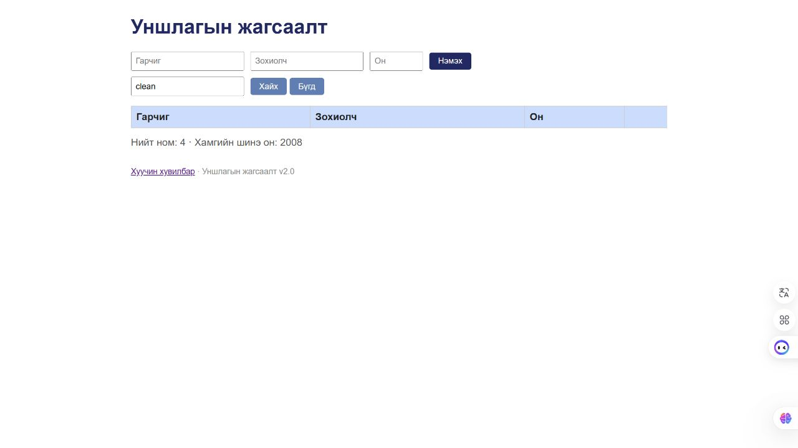

# BUG-07: Гарчиг зохиолчийн хайлт том жижиг үсэг ялгадаг

Орчин: Reading List v2.0; Node.js v24.13.0; Codex In-app Browser (ажигласан User-Agent Chrome/155.0.0.0); Windows x64, 25H2, build 26200.9711; 2026-10-21.
API хэрэгсэл: curl.exe 8.21.0.
Урьдчилсан нөхцөл: Өмнөх node app.js process-ийг Ctrl+C-ээр зогсоож node app.js-ийг дахин асаасан; браузераа reload хийсэн; GET /api/books нь id 1, 2, 3 бүхий Тунгалаг Тамир, Clean Code, The Pragmatic Programmer гэсэн яг гурван ном буцаана. Page reload дангаараа server reset биш.

## Дахин гаргах алхам

1. Хайх үг талбарт clean гэж бичээд Хайх дарна.
2. Үр дүнг хадгалаад Clean Code гэж өөрчилж дахин Хайх дарна.
3. robert болон Robert гэсэн хоёр author хайлтыг мөн харьцуулна.

Хүлээгдэж байсан: Хайлт гарчиг болон зохиолчоос хайж, том/жижиг үсэг ялгахгүй.

Бодит үр дүн: clean ба robert үед мөр олдоогүй; Clean Code ба Robert үед нэг seeded ном олдсон. Кирилл Өгүүллэг/өгүүллэг, Тест Зохиолч/тест зохиолч хувилбарууд ч үсэг ялгасан.

Ноцтой байдал: Minor — Үсгийн хэлбэрээс болж байгаа номоо олохгүй; яг таарсан case ашиглавал олдоно.

Олдсон аялал: Fed-Ex.

## Хавсралт

[Яг ижил title-ийн хяналт](../screenshots/session-03/search-exact-title.jpg) · [Жижиг үсгийн author](../screenshots/session-03/search-lowercase-author.jpg) · [Author хяналт](../screenshots/session-03/search-exact-author.jpg)

## Нэмэлт тодруулга

Үндсэн алхмыг duplicate мөргүй, шинээр асаасан server дээр хийсэн. Олдохгүй query хоосон, хоосон query гурван seeded номыг буцаасан нь тусдаа positive/negative control юм.
