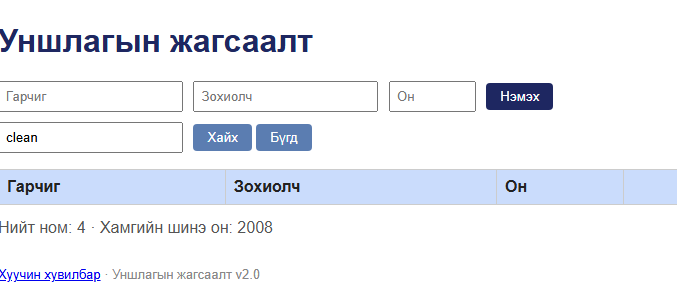

# BUG-07: Хайлт том, жижиг үсгийг ялгадаг

Орчин: Reading List v2.0 UI reproduction, Opera One 136.0.6008.80 (Chromium 152.0.7977.134), Windows 11 64-bit, 2026-10-15
Урьдчилсан нөхцөл: App default 3 seeded book state-д Clean Code жагсаалтад байна.

## Дахин гаргах алхам
1. Хайлтын талбарт clean гэж жижиг үсгээр бичнэ.
2. “Хайх” дарж үр дүнг шалгана.
3. Хайлтыг Clean Code гэж бичээд дахин шалгана.

Хүлээгдэж байсан: Хайлт гарчиг болон зохиолчоос хайх ба том/жижиг үсэг ялгахгүй.
Бодит үр дүн: clean үед хоосон үр дүн гарсан; Clean Code үед ном гарсан. Зохиолчийг robert гэж жижиг үсгээр хайхад мөн үр дүн гараагүй; Robert гэж хайхад таарсан ном гарсан.
Ноцтой байдал: Minor — зөвхөн үсгийн хэлбэр өөр байсан ч хэрэглэгч номоо олохгүй.
Хавсралт: 
Олдсон аялал: Supermodel.
