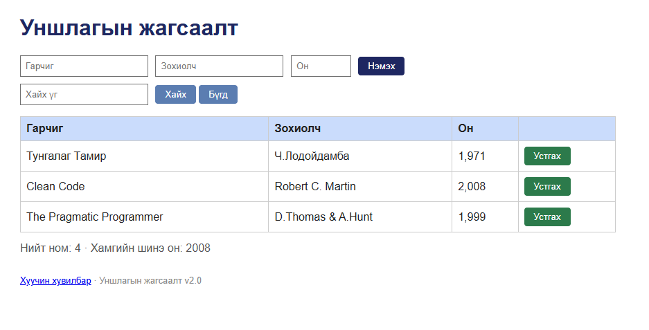

# BUG-09: “Устгах” товчнууд улаан биш ногоон

Орчин: Reading List v2.0, Codex In-app Browser (version unavailable), Windows (version unavailable), 2026-10-15  
Урьдчилсан нөхцөл: App default 3 seeded book state-д байна.

## Дахин гаргах алхам
1. Уншлагын жагсаалтын хүснэгтийг нээнэ.
2. “Устгах” товчнуудын өнгийг ажиглана.

Хүлээгдэж байсан: Аюултай үйлдлийн товч (Устгах) улаан өнгөтэй.
Бодит үр дүн: Гурван “Устгах” товч бүгд ногоон өнгөтэй.
Ноцтой байдал: Cosmetic — ажиллагаа хэвийн ч аюултай үйлдлийн визуал дохио спецификац зөрчсөн.
Хавсралт: 
Олдсон аялал: Supermodel.
