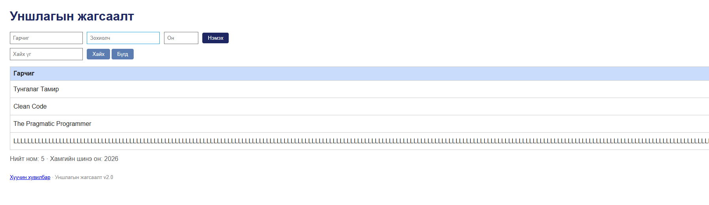

# BUG-10: Урт тасралтгүй текст хүснэгтийг өргөнөөр эвддэг

Орчин: Reading List v2.0, Codex In-app Browser (version unavailable), Windows (version unavailable), 2026-10-15  
Урьдчилсан нөхцөл: App default 3 seeded book state-д байна.

## Дахин гаргах алхам
1. Гарчигт 300 ширхэг L, зохиолчид 300 ширхэг A, онд 2026 оруулна.
2. “Нэмэx” дарна.
3. Хүснэгтийн баганууд болон viewport-ийн өргөнийг шалгана.

Хүлээгдэж байсан: Хүснэгт ямар ч урттай оролтод эвдрэхгүй.
Бодит үр дүн: Тасралтгүй текст баганын өргөнийг тэлж, viewport-оос хэтрүүлсэн; зохиолч, он болон товчийг харахын тулд хэвтээ scroll шаардлагатай болсон.
Ноцтой байдал: Minor — урт утгатай мөрийг харах, бусад баганатай харьцуулах хүндрэлтэй.
Хавсралт: 
Олдсон аялал: Couch Potato.
