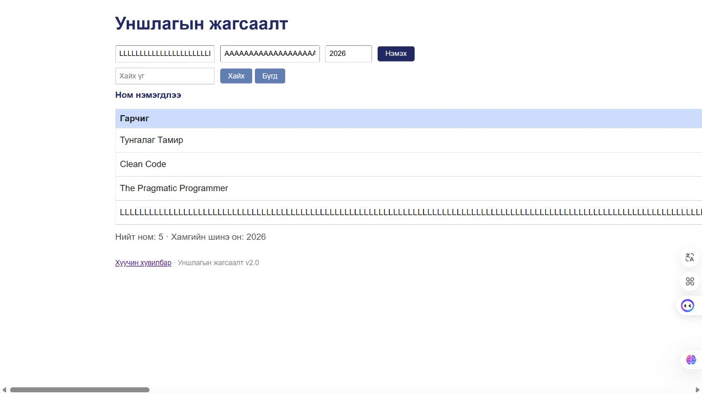

# BUG-10: 300 тэмдэгттэй тасралтгүй текст хүснэгтийг дэлгэцээс хэт өргөн болгодог

Орчин: Reading List v2.0; Node.js v24.13.0; Codex In-app Browser (ажигласан User-Agent Chrome/155.0.0.0); Windows x64, 25H2, build 26200.9711; 2026-10-21.
API хэрэгсэл: curl.exe 8.21.0.
Урьдчилсан нөхцөл: Өмнөх node app.js process-ийг Ctrl+C-ээр зогсоож node app.js-ийг дахин асаасан; браузераа reload хийсэн; GET /api/books нь id 1, 2, 3 бүхий Тунгалаг Тамир, Clean Code, The Pragmatic Programmer гэсэн яг гурван ном буцаана. Page reload дангаараа server reset биш.

## Дахин гаргах алхам

1. Гарчигт яг 300 ширхэг L, зохиолчид яг 300 ширхэг A, онд 2026 оруулна.
2. Нэмэx дарна.
3. Хүснэгтийн бусад багана, хэвтээ scrollbar болон viewport-оос хальсан хэсгийг ажиглана.

Хүлээгдэж байсан: “Хүснэгт ямар ч урттай оролтод эвдрэхгүй” дүрмээр title/author нь wrap эсвэл зохистой containment-тэй байж бусад баганыг дэлгэцээс түлхэхгүй.

Бодит үр дүн: 1280 px viewport дээр хэвийн 860 px хүснэгт 6045 px болж, document width 6255 px болсон; author/year/delete баганыг харахын тулд хэвтээ scroll хэрэгтэй болсон.

Ноцтой байдал: Minor — Урт утгатай мөрийг унших, бусад талбар болон устгалд хүрэхэд хүндрэлтэй.

Олдсон аялал: Supermodel.

## Хавсралт

[Халилтын хэмжилт](../evidence/session-03/long-text-ui-metrics.json) · [Хэвийн хэмжилт](../evidence/session-03/baseline-ui-metrics.json) · [Ижил урттай зайтай текстийн хяналт](../evidence/session-03/spaced-text-ui-metrics.json)

## Нэмэлт тодруулга

300 тэмдэгттэй боловч зайтай title/author нь 860 px өргөнд wrap хийсэн. Иймээс “бүх урт текст” бус, “тасралтгүй урт текст” гэсэн нөхцөлийг тодорхой бичсэн.
