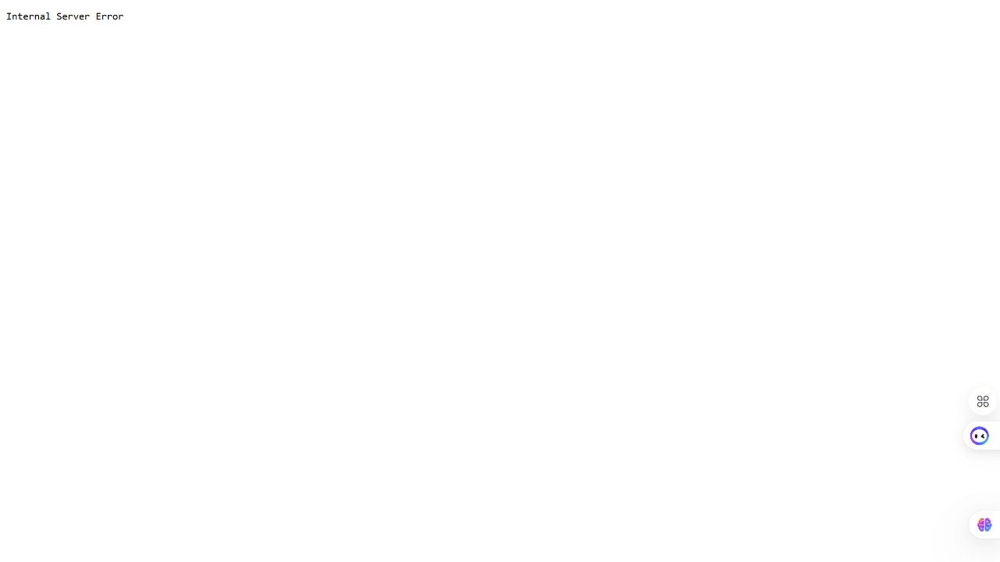

# BUG-11: Хуучин хувилбар холбоос HTTP 500 бүхий алдааны хуудас нээдэг

Орчин: Reading List v2.0; Node.js v24.13.0; Codex In-app Browser (ажигласан User-Agent Chrome/155.0.0.0); Windows x64, 25H2, build 26200.9711; 2026-10-21.
API хэрэгсэл: curl.exe 8.21.0.
Урьдчилсан нөхцөл: Өмнөх node app.js process-ийг Ctrl+C-ээр зогсоож node app.js-ийг дахин асаасан; браузераа reload хийсэн; GET /api/books нь id 1, 2, 3 бүхий Тунгалаг Тамир, Clean Code, The Pragmatic Programmer гэсэн яг гурван ном буцаана. Page reload дангаараа server reset биш.

## Дахин гаргах алхам

1. Үндсэн http://localhost:3000/ хуудсыг нээнэ.
2. Доод хэсгийн Хуучин хувилбар холбоосыг дарна.
3. /old руу шилжсэн хуудасны бичвэрийг уншиж, curl -i http://localhost:3000/old-оор статусыг батална.

Хүлээгдэж байсан: Спецификацийн дагуу бүх хуудас, линк ажиллана; холбоос зорьсон хуудсаа амжилттай нээх ёстой.

Бодит үр дүн: /old дээр Internal Server Error харагдаж HTTP/1.1 500 Internal Server Error ирсэн; үндсэн /api/books хэвийн 200 хэвээр байсан.

Ноцтой байдал: Minor — Хоёрдогч холбоосын боломж бүхэлдээ ажиллахгүй; үндсэн номын урсгал үргэлжилж байна.

Олдсон аялал: Supermodel.

## Хавсралт

[Baseline, /old болон health GET-ийн бүтэн curl](../evidence/session-03/bug-11-curl.txt)

## Нэмэлт тодруулга

2026-10-15-ны браузерийн about:blank/blocked ажиглалтыг энэ дүгнэлтэд ашиглаагүй; 2026-10-21-нд шинээр асаасан server дээр бодитоор дагасан.
