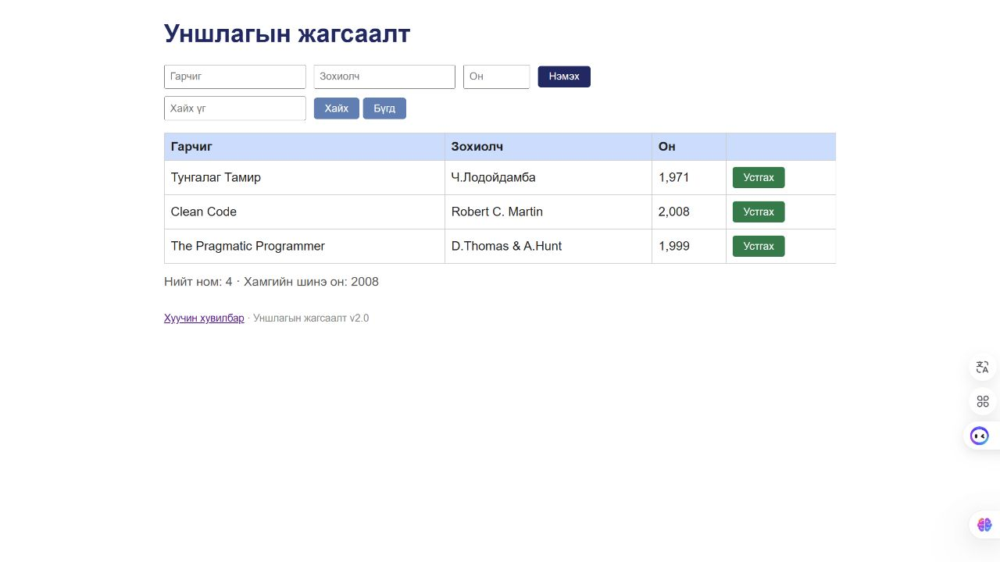

# BUG-12: Нэмэх товчны сүүлчийн үсэг кирилл х-ийн оронд латин x байна

Орчин: Reading List v2.0; Node.js v24.13.0; Codex In-app Browser (ажигласан User-Agent Chrome/155.0.0.0); Windows x64, 25H2, build 26200.9711; 2026-10-21.
API хэрэгсэл: curl.exe 8.21.0.
Урьдчилсан нөхцөл: Өмнөх node app.js process-ийг Ctrl+C-ээр зогсоож node app.js-ийг дахин асаасан; браузераа reload хийсэн; GET /api/books нь id 1, 2, 3 бүхий Тунгалаг Тамир, Clean Code, The Pragmatic Programmer гэсэн яг гурван ном буцаана. Page reload дангаараа server reset биш.

## Дахин гаргах алхам

1. Үндсэн хуудсын нэмэх товчны харагдах бичвэрийг уншиж хуулна.
2. Товчны DOM text нь Нэмэx болохыг, сүүлчийн character U+0078 болохыг код цэгээр шалгана.
3. Зөв Монгол Нэмэх үгийн кирилл х нь U+0445 болохтой харьцуулна.

Хүлээгдэж байсан: “Текстүүд үсгийн алдаагүй” дүрмээр Монгол Нэмэх үгийг бүхэлд нь кирилл үсгээр бичнэ.

Бодит үр дүн: Нэмэx гэсэн холимог бичвэртэй; сүүлчийн үсэг нь Latin Small Letter X, U+0078 байна.

Ноцтой байдал: Cosmetic — Үйлдэл ажиллах боловч Монгол бичвэрийн үсгийн найрлага буруу; дүрс төстэй тул зөвхөн screenshot-аар кодын ялгааг батлахгүй.

Олдсон аялал: Supermodel.

## Хавсралт

[Харагдах DOM text ба Unicode code point-ийн нотолгоо](../evidence/session-03/add-button-label.json)

## Нэмэлт тодруулга

Энэ нь app.js-ийн source-оос хайж олсон мөр биш; хэрэглэгчид харагдах button text-ийг уншсан нотолгоо юм.
