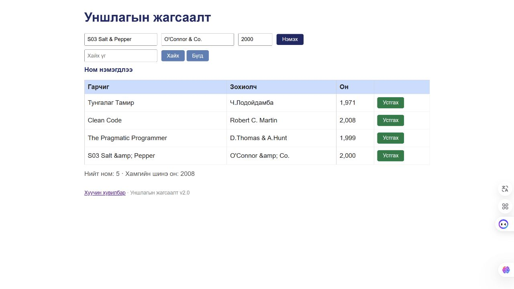

# BUG-13: Ampersand-тэй title author өөрчлөгдөн хадгалагдаж яг ижил хайлт бүтэлгүйтдэг

Орчин: Reading List v2.0; Node.js v24.13.0; Codex In-app Browser (ажигласан User-Agent Chrome/155.0.0.0); Windows x64, 25H2, build 26200.9711; 2026-10-21.
API хэрэгсэл: curl.exe 8.21.0.
Урьдчилсан нөхцөл: Өмнөх node app.js process-ийг Ctrl+C-ээр зогсоож node app.js-ийг дахин асаасан; браузераа reload хийсэн; GET /api/books нь id 1, 2, 3 бүхий Тунгалаг Тамир, Clean Code, The Pragmatic Programmer гэсэн яг гурван ном буцаана. Page reload дангаараа server reset биш.

## Дахин гаргах алхам

1. Гарчигт S03 Salt & Pepper, зохиолчид O'Connor & Co., онд 2000 оруулж нэмнэ.
2. Шинэ мөрийн title/author-ийг оруулсан утгатай харьцуулна.
3. Хайлтанд S03 Salt & Pepper гэж яг адил үсгээр хайна.
4. Хяналт болгон S03 Salt гэж богиносгож хайна; GET /api/books-ээр хадгалсан утгыг уншина.

Хүлээгдэж байсан: Хэрэглэгчийн хүчинтэй title/author текст & тэмдэгттэйгээ өөрчлөгдөхгүй хадгалагдаж харагдах нь эрүүл ухааны oracle; гарчгаар хайх шаардлагаар яг ижил title номоо олно. HTML тэмдэгтийг аюулгүй харагдуулахдаа бизнес өгөгдлийг literal entity текст болгох ёсгүй.

Бодит үр дүн: `S03 Salt &amp; Pepper` болон `O'Connor &amp; Co.` гэж харагдаж, API JSON-д ч literal `&amp;` хадгалагдсан. Яг оруулсан title query хоосон; `S03 Salt` query номыг олсон.

Ноцтой байдал: Minor — Харагдах болон хайгдах өгөгдөл өөрчлөгдөнө; хэсэгчилсэн query-гаар номыг олж болох ч оруулсан нэрээр нь олохгүй.

Олдсон аялал: Fed-Ex.

## Хавсралт

[Яг ижил title query](../screenshots/session-03/encoded-title-search.jpg) · [Богино query-ийн хяналт](../screenshots/session-03/encoded-title-control.jpg) · [Тусдаа шинэ server дээрх request body ба бүтэн curl](../evidence/session-03/bug-13-curl.txt)

## Нэмэлт тодруулга

Бүх талбар хүчинтэй, year=2000, query-ийн letter case яг ижил тул BUG-02/03/07-ын хувилбар гэж тооцоогүй. Байгууллагын нэр дэх энгийн & ч асуудлыг гаргана; script payload шаардахгүй.
